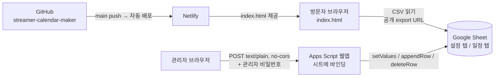
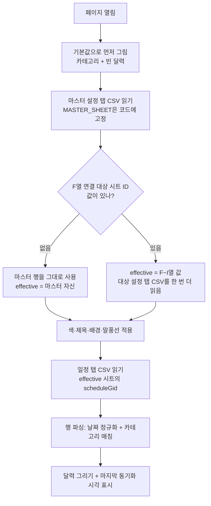
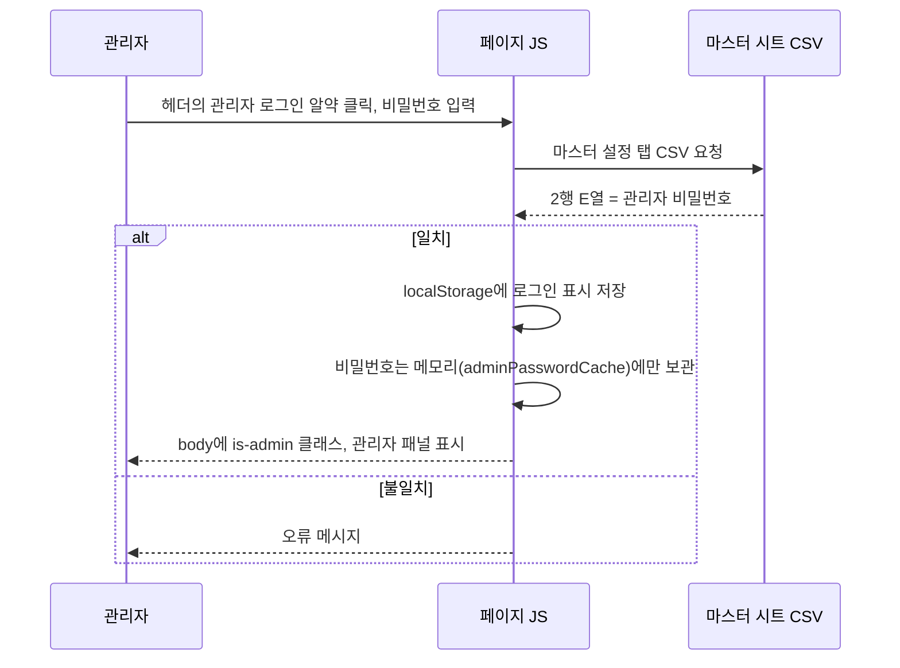
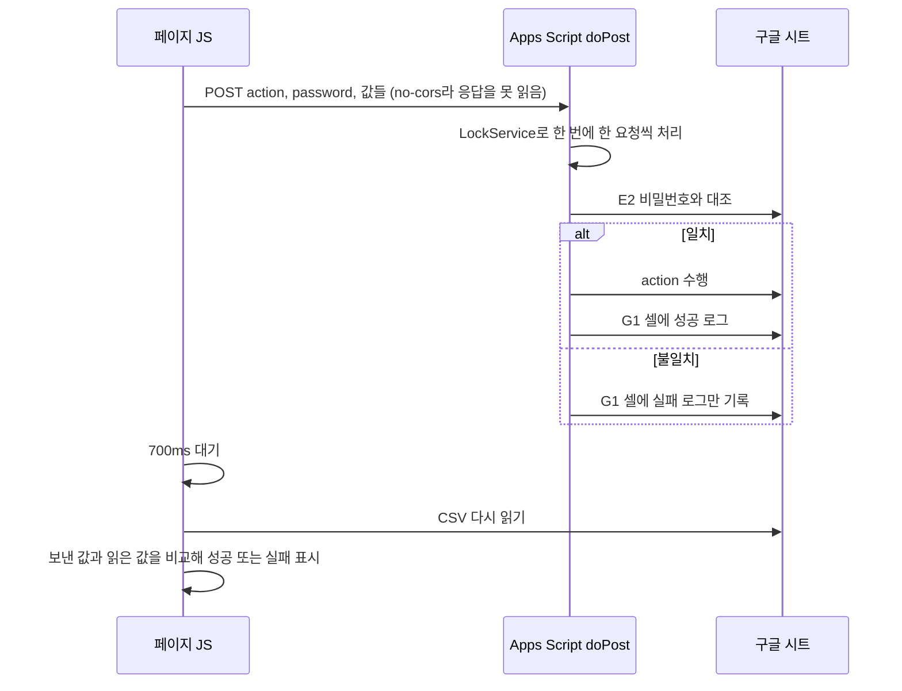
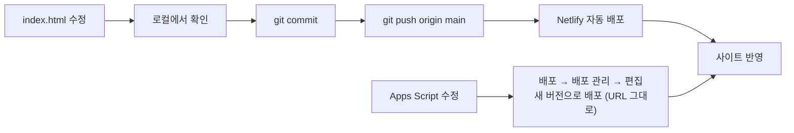
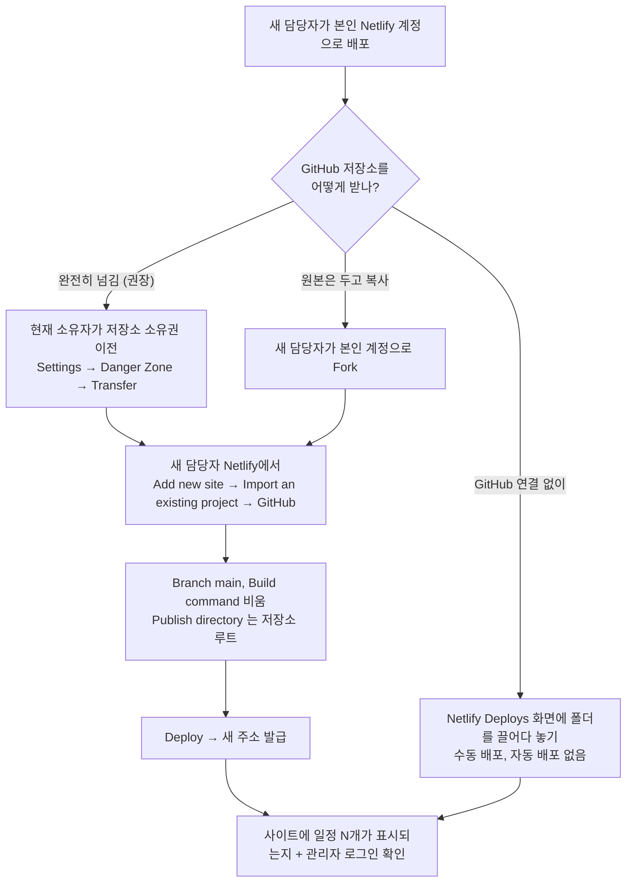

# 설홍 방송 일정표 (streamer-calendar-maker) 인수인계 문서

스트리머의 월간 방송 일정을 달력으로 보여주고, PNG로 저장해 공유할 수 있게 만든 정적 웹페이지입니다.
서버 없이 **HTML 한 파일 + 구글 시트 + Apps Script** 세 가지로 동작합니다.

| | |
|---|---|
| 배포 사이트 | https://lighthoongcalendar.netlify.app/ |
| 소스 저장소 | https://github.com/Tricksters7547/streamer-calendar-maker (브랜치 `main`, 파일은 `index.html` 하나) |
| 데이터 시트 | https://docs.google.com/spreadsheets/d/1LrZ-RqPqQcHITn1aiTAyI6CNtf0y0b6gMDRyvC6UK2o/edit |
| 배포 방식 | `main`에 push → Netlify가 자동 배포 |

---

## 1. 전달 체크리스트

소스 코드(1번)는 저장소에 있지만, 나머지 2~5번은 **저장소 밖**에 있어서 따로 권한이나 값을 전달해야 합니다.

| # | 항목 | 어디에 있나 | 새 담당자에게 필요한 것 | 전달 방법 |
|---|------|-------------|------------------------|-----------|
| 1 | 소스 코드 | GitHub `streamer-calendar-maker` | 쓰기 권한 | Settings → Collaborators → 초대 |
| 2 | 구글 시트 | 위 링크 (탭 2개) | **편집자** 권한 | 시트 공유 → 이메일 추가 |
| 3 | Apps Script | 시트에 바인딩됨 (시트 메뉴 `확장 프로그램 → Apps Script`) | 시트 편집자면 열 수 있음. 원본은 [`apps-script/Code.gs`](apps-script/Code.gs) | 시트 권한 + 이 저장소의 사본 |
| 4 | Netlify 사이트 | 현재 소유자의 Netlify 계정 (`lighthoongcalendar`) | **새 담당자가 본인 Netlify 계정으로 사이트를 새로 만듭니다.** 현재 소유자 계정에는 초대하지 않습니다 | 12장의 순서대로 새 담당자가 직접 진행 |
| 5 | 관리자 비밀번호 | 시트 설정 탭 **E2** 셀 | 값 | 문서에 적지 말고 메신저 등으로 따로 전달 |

> **계정이 넘어가는 순서가 중요합니다.** Netlify 연결에는 GitHub 저장소 접근이 먼저 필요하므로 `1 → 4` 순서로 진행하세요. 소유 계정이 바뀌는 항목(GitHub, Netlify, 구글 시트·Apps Script)의 정리 방법은 12장에 모아 두었습니다.

**한눈에 보기: 무엇을 보내면 되나**

| 보낼 것 | 방법 | 비고 |
|---------|------|------|
| **소스 코드 `index.html`** | GitHub 저장소 소유권 이전 또는 Fork (12장). 급하면 `index.html` 파일을 직접 전달 | 이 문서와 `Code.gs`만으로는 개발을 시작할 수 없습니다. **코드는 이 문서 폴더에 들어 있지 않습니다** |
| 이 문서 (PDF 또는 HANDOVER.md) | 파일 전달 | 구조, 시트 구성, 설정 순서, 한계 |
| `apps-script/Code.gs` | 파일 전달 (저장소에 올려 두면 더 좋음) | Apps Script 사본. 새로 배포할 때 필요 |
| 구글 시트 | 같은 시트를 계속 쓸 때: 편집자로 공유. 새로 시작할 때: 사본 만들기 (12.2) | 데이터와 Apps Script가 여기에 있음 |
| 관리자 비밀번호 | 메신저 등으로 따로 | 시트 설정 탭 E2 값 |
| Netlify | 전달할 것 없음 | 새 담당자가 본인 계정으로 새로 만듦 (12.1) |

**전달 전에 확인할 것**
- Apps Script 웹앱 배포 설정이 `실행 사용자: 나`, `액세스: 모든 사용자`인지 (그래야 로그인 없이 POST가 들어옵니다). 담당자를 바꿀 때 이 설정이 소유자 계정에 묶여 있다는 점도 같이 알려주세요.
- 시트 공유 설정이 `링크가 있는 모든 사용자 - 뷰어`인지 (방문자가 CSV로 읽기 때문).

---

## 2. 전체 구조



핵심 아이디어는 세 가지입니다.

1. **읽기는 시트에서 직접.** 모든 방문자의 브라우저가 구글 시트 CSV 내보내기 주소를 직접 읽습니다. 서버가 없습니다.
2. **쓰기는 Apps Script로만.** CSV 내보내기는 읽기 전용이라, 관리자가 저장·추가·삭제할 때만 Apps Script 웹앱에 POST 합니다.
3. **바뀌는 값은 전부 시트에.** 색, 제목, 배경, 일정, 말풍선 문구, 심지어 "어느 시트를 볼지"까지 시트에 있어서 코드를 고쳐 재배포하지 않아도 모든 방문자에게 반영됩니다. (예외는 카테고리 목록, 9장 참고)

---

## 3. 구글 시트 구조

스프레드시트 ID: `1LrZ-RqPqQcHITn1aiTAyI6CNtf0y0b6gMDRyvC6UK2o`

### 설정 탭 (gid `1577649692`) — 1행은 헤더, **2행이 데이터**

| 열 | 내용 | 쓰는 곳 |
|----|------|---------|
| A | 메인컬러 (`#db2452`) | 테마 색 |
| B | 서브컬러 (`#7af07c`) | 테마 색 |
| C | 캘린더 제목 | 달력 위 알약 |
| D | 배경 이미지 URL | 달력 배경 (Imgur 등 직접 링크) |
| E | **관리자 비밀번호** | 로그인 확인, Apps Script 쓰기 검증. **항상 이 마스터 시트의 값** |
| F | 연결 대상 스프레드시트 ID | 비어 있으면 "마스터 시트 자신을 사용" |
| G | 연결 대상 설정 탭 gid | |
| H | 연결 대상 일정 탭 gid | |
| I | 연결 대상 Apps Script URL | 비어 있으면 마스터의 URL을 씁니다. **다른 스프레드시트로 전환할 때는 반드시 채우세요.** 비워 두면 읽기는 대상 시트에서 하는데 쓰기는 마스터 시트로 들어갑니다 |
| J | 상단 띠 말풍선 문구 | 비어 있으면 `♡ 오늘도 함께해요` |

> `G1` 셀은 설정값이 아닙니다. Apps Script가 마지막 처리 결과를 적는 **디버그 로그 칸**이라, 쓰기가 안 될 때 가장 먼저 여기를 보면 원인이 나옵니다. (`G2`는 위 표의 설정 칸이라 서로 다른 셀입니다.)

### 일정 탭 (gid `1998787329`) — 1행은 헤더

| 열 | 내용 | 비고 |
|----|------|------|
| A | 날짜 | `2026-08-20`, `2026.08.20`, `2026/8/20` 모두 인식 |
| B | 카테고리 | 카테고리 이름과 같아야 매칭. 기본 4종은 별칭(`방송`, `휴방` 등)도 인식 |
| C | 내용 | 달력 태그에 표시 (입력창 기준 18자 제한) |

---

## 4. 동작 흐름

### 4.1 페이지를 열 때 (읽기)



- 입구는 항상 `MASTER_SHEET`(코드에 고정). 여기서 읽은 F~I열이 "지금 어느 시트를 볼지"를 정합니다.
- 이 한 단계 간접 참조 덕분에 관리자가 시트를 바꿔도 코드 수정이 필요 없습니다.

### 4.2 관리자 로그인



로그인은 **브라우저에서 비밀번호를 비교하는 가벼운 잠금**입니다. 진짜 인증이 아닙니다 (10장 참고).

### 4.3 관리자가 값을 저장할 때 (쓰기)

일정 추가/삭제, 설정 저장, 시트 전환이 모두 같은 방식입니다.



| action | 하는 일 | 보내는 곳 |
|--------|---------|-----------|
| `updateSettings` | A2:D2 (색·제목·배경) + J2 (말풍선) 기록 | 현재 활성 시트의 Apps Script |
| `addSchedule` | 일정 탭에 한 행 추가 | 현재 활성 시트의 Apps Script |
| `deleteSchedule` | (날짜, 카테고리, 내용)이 같은 첫 행 삭제 | 현재 활성 시트의 Apps Script |
| `updateSheetPointer` | F2:I2 (연결 대상) 기록. 전부 비우면 기본 시트로 복귀 | **항상 마스터의 Apps Script** |

`no-cors`로 보내는 이유: Apps Script 응답에는 CORS 헤더가 없어 브라우저가 응답을 막습니다. 요청 자체는 처리되지만 성공 여부를 알 수 없어서, **다시 읽어서 값이 바뀌었는지**로 판단합니다. 그래서 쓰기 코드 곳곳에 "WRITE_NOT_VERIFIED" 처리가 있습니다.

### 4.4 개발 → 배포



Apps Script는 **저장만으로는 반영되지 않습니다.** 반드시 새 버전으로 배포해야 합니다.

---

## 5. 어디에 무엇이 저장되나

| 데이터 | 저장 위치 | 모든 방문자에게 반영? |
|--------|-----------|----------------------|
| 색, 제목, 배경, 말풍선 문구 | 구글 시트 설정 탭 | 예 (즉시) |
| 일정 | 구글 시트 일정 탭 | 예 (즉시) |
| 연결할 시트(포인터) | 구글 시트 설정 탭 F~I | 예 (즉시) |
| 관리자 비밀번호 | 구글 시트 설정 탭 E2 | - |
| **카테고리 목록** | 코드의 `DEFAULT_STATE.categories` | 코드 수정 + 배포가 필요 |
| 관리자가 편집 중인 카테고리 | 관리자 브라우저 localStorage (`streamerCalendarMaker.v1`) | 아니오 (그 브라우저만) |
| 로그인 상태 | localStorage (`streamerCalendarMaker.adminUnlocked.v1`) | - |
| 로그인한 비밀번호 | 메모리 변수 `adminPasswordCache` (새로고침하면 사라짐) | - |

---

## 6. 코드 지도 (`index.html`, 약 2,300줄 단일 파일)

위에서 아래로 `CSS → HTML → JS` 순서입니다. 줄 번호는 바뀌므로 함수 이름으로 찾으세요.

**CSS**
- 맨 위 `:root`에 디자인 토큰(색·반경·그림자). `--main-color`/`--sub-color`는 시트 값으로 JS가 덮어씁니다.
- `--main-rgb`/`--sub-rgb`는 같은 색의 `R, G, B` 값으로, `rgba(var(--main-rgb), .1)` 같은 연한 배경을 테마색에 맞춰 만들 때 씁니다 (`applyThemeColors`가 같이 갱신).
- `#calendar-capture` 안에서는 `backdrop-filter`, `color-mix`, 두 위치 색 정지점(`red 0 60%`)을 쓰지 않습니다. PNG 저장(html2canvas)이 제대로 그리지 못합니다.
- 방문자/관리자 화면 전환은 `body.is-admin` 클래스 하나로 CSS가 처리합니다.

**HTML** — `헤더(브랜드 + 관리자 알약/팝오버)` → `히어로 띠` → `캘린더 카드 (+PNG 버튼)` → `관리자 카드(관리자일 때만)` → `푸터`

**JS 주요 함수**

| 영역 | 함수 / 상수 | 역할 |
|------|-------------|------|
| 시트 설정 | `MASTER_SHEET`, `MASTER_APPS_SCRIPT_URL`, `DEFAULT_SHEET_CONFIG`, `currentPointer`, `effectiveSheetConfig` | 고정 입구, 포인터 원본값, 지금 실제로 읽는 시트 |
| 읽기 | `fetchSheetCsv`, `parseCsv`, `syncSettingsFromSheet`, `syncSchedulesFromSheet` | CSV 읽기와 화면 반영 |
| 쓰기 | `writeToUrl`, `writeToSheet`, `writeToMasterSheet` | Apps Script로 POST (활성 시트용 / 마스터 전용) |
| 로그인 | `tryAdminLogin`, `applyAdminModeUI`, `toggleAdminPopover`, `isAdminUnlocked` | 비밀번호 확인, 화면 전환 |
| 시트 전환 | `fillSheetConfigInputs`, `switchSheetBtn`/`resetSheetBtn` 핸들러 | 포인터 F~I 쓰기와 검증 |
| 달력 | `renderCalendar`, `selectDateForNewSchedule` | 6주 42칸 그리기, 날짜 클릭 선택 |
| 일정 | `addScheduleInBackground`, `deleteScheduleFromSheet` | 낙관적 UI로 추가, 삭제 후 재조회 |
| 카테고리 | `renderCategories`, `addCategory`, `removeCategory`, `normalizeCategory` | 목록 편집, 시트의 카테고리 이름 → key 매칭 |
| 테마 | `applyThemeColors`, `hexToRgbTriplet`, `applyHeroTag` | 색, 말풍선 |
| 저장 | `downloadBtn` 핸들러 | html2canvas로 `#calendar-capture`를 PNG로 (scale 2) |

---

## 7. Apps Script ([`apps-script/Code.gs`](apps-script/Code.gs))

- `doPost(e)` 하나가 모든 쓰기를 처리하고, `doGet`은 안내 문구만 돌려줍니다.
- 순서: `LockService` 획득 → JSON 파싱 → 설정 탭 E2와 `body.password` 대조 → `action` 분기 → G1에 결과 로그.
- **Apps Script 원본은 구글 서버에만 있어서**, 이 저장소의 `apps-script/Code.gs`가 사본입니다. 수정하면 양쪽을 같이 맞춰 주세요.
- 상단 `SETTINGS_GID`, `SCHEDULE_GID`가 탭을 가리킵니다. 탭을 새로 만들면 이 값을 바꿔야 합니다.

---

## 8. 로컬 개발

1. 저장소를 clone 하고 `index.html`을 수정합니다.
2. **`file://`로 열면 시트 동기화와 로그인이 막힙니다** (코드에서 일부러 막아 둠). 간단한 서버로 여세요.
   ```bash
   python -m http.server 8000      # → http://localhost:8000
   ```
3. 시트 쓰기를 실제로 시험하면 운영 시트가 바뀝니다. 연습용 시트가 필요하면 시트를 복사하고 11장을 따라 연결을 바꾸세요.
4. 줄바꿈: 저장소의 `index.html`은 **CRLF**입니다. 에디터가 LF로 바꾸면 diff가 파일 전체로 나오니 설정을 확인하세요.
5. 커밋은 `main`에 push 하면 곧바로 운영에 반영됩니다. 브랜치/PR 흐름을 쓰려면 Netlify의 Deploy Preview 설정을 켜 두는 걸 권장합니다.

---

## 9. 알려진 한계와 개선 후보

우선순위 높은 순입니다.

| # | 내용 | 영향 | 제안 |
|---|------|------|------|
| 1 | **관리자 비밀번호가 사실상 공개.** 시트 CSV가 공개 조회라 E2 값을 누구나 읽을 수 있고, 그 값으로 Apps Script에 직접 POST 하면 시트를 바꿀 수 있음 | 보안 | 비밀번호를 서버 쪽(Apps Script의 Script Properties 등)으로 옮기거나 Google 계정 인증으로 교체. 당장은 다른 곳에서 쓰는 비밀번호를 재사용하지 않기 |
| 2 | **새로고침하면 쓰기가 조용히 실패.** 로그인 표시는 localStorage에 남지만 비밀번호는 메모리에만 있어서, 새로고침 후 저장하면 "반영되지 않았어요"가 뜸 | 사용성 | 새로고침 시 로그인 표시를 지우거나, 비밀번호를 sessionStorage에 보관 |
| 3 | **카테고리가 시트 밖에 있음.** 사이트 전체에 반영하려면 코드(`DEFAULT_STATE`)를 고쳐 재배포해야 함. 관리자 화면의 "설정 복사하기" 버튼이 이를 위한 임시 수단 | 운영 | 카테고리 탭을 시트에 추가해 읽기 |
| 4 | **연결 시트의 비밀번호.** 다른 시트로 전환해도 쓰기에는 마스터 비밀번호를 보냅니다. 대상 시트의 Apps Script는 자기 E2와 비교하므로 **대상 시트 E2도 같은 값**이어야 쓰기가 됩니다 | 운영 | 문서화 또는 비밀번호 비교를 마스터로 통일 |
| 5 | 쓰기 성공 여부를 못 읽고 재조회로만 확인. 구글 CSV 캐시 지연이 있으면 성공해도 실패로 보일 수 있음 | 안정성 | 재시도 1회 추가, 또는 JSONP/프록시로 응답 읽기 |
| 6 | 방문자마다 구글 문서 서버로 CSV 요청 2~3건. 방문자가 많으면 제한에 걸릴 수 있음 | 확장성 | Netlify Function으로 캐싱 |
| 7 | 2,300줄 단일 파일, 자동 테스트 없음 | 유지보수 | 파일 분리(또는 번들러), 파서·날짜 함수부터 단위 테스트 |
| 8 | PNG 저장 시 배경 이미지 서버가 CORS를 허용해야 함 (Imgur는 가능) | 호환성 | 안내 문구 추가 |

---

## 10. 보안 메모

- 이 구조에서 "관리자 로그인"은 팬이 실수로 설정을 건드리지 않게 하는 **가벼운 잠금**입니다. 9장 1번 참고.
- 비밀번호, 시트 ID, Apps Script URL이 모두 공개 코드/공개 시트에서 읽힙니다. 민감한 값은 넣지 마세요.
- 저장소가 Public이고 Netlify가 루트를 그대로 서빙하므로, 저장소에 올린 문서도 사이트 주소로 열람됩니다. 이 문서에는 비밀번호를 적지 않았습니다.

---

## 11. 다른 스트리머용으로 복제할 때 바꿀 곳

**A. 시트 연결을 바꾸는 방법 (코드 수정 없음)** — 관리자 로그인 후 `🔗 연결된 구글 시트`(▶ 버튼으로 펼침)에 새 시트 URL, 설정 탭 gid, 일정 탭 gid, 그 시트의 Apps Script URL을 넣고 `이 시트로 전환`. 새 시트 조건:
- 같은 탭 구성과 열 구성 (3장)
- `링크가 있는 모든 사용자 - 뷰어`로 공유
- 같은 Apps Script를 그 시트에도 붙여 새 버전으로 배포
- 설정 탭 E2에 **같은 관리자 비밀번호** (9장 4번)

**B. 사이트를 통째로 새로 만드는 경우 (코드 수정 필요)**

| 바꿀 것 | 위치 |
|---------|------|
| 시트 ID, 설정 탭 gid, Apps Script URL | `MASTER_SHEET`, `MASTER_APPS_SCRIPT_URL`, `DEFAULT_SHEET_CONFIG.scheduleGid` |
| Apps Script의 탭 gid | `Code.gs` 상단 `SETTINGS_GID`, `SCHEDULE_GID` |
| 브랜드 문구 | `<title>`, 헤더 `설`/`SEOLHONG`/`설홍의 방송 일정표`, 히어로 문구, 푸터 |
| 기본 카테고리 | `DEFAULT_STATE.categories`, `normalizeCategory` 안의 `defaultAliases` |
| 안내 문구 속 "매실이" | 화면 곳곳의 "매실이에게 문의/배포 요청" 문구 → 새 담당자 이름으로 (이전에 AI 어시스턴트를 가리키던 이름) |

**C. 새 시트와 새 Apps Script로 처음부터 세팅하는 순서**

자기 구글 계정에서 시작할 때(위 B 포함) 필요한 순서입니다. Apps Script 웹앱을 처음 배포할 때 막히기 쉬운 곳까지 적었습니다.

1. **시트 만들기.** 새 구글 시트에 탭 2개(설정, 일정)를 만듭니다. 구성은 3장과 같고, 처음에는 이렇게 채웁니다.

   | 설정 탭 | A | B | C | D | E | F~I | J |
   |---------|---|---|---|---|---|-----|---|
   | 1행 (헤더) | 메인컬러 | 서브컬러 | 캘린더제목 | 배경이미지URL | 관리자비밀번호 | (비워 둠) | 말풍선문구 |
   | 2행 (값) | `#db2452` | `#7af07c` | 우리 방송표 | 이미지 주소 (없으면 비움) | 직접 정한 비밀번호 | (비워 둠) | (비워 둠) |

   일정 탭은 1행에 `날짜 / 카테고리 / 내용`, 2행부터 일정을 적습니다. **1행은 비워 두면 안 됩니다.** 코드는 완전히 빈 행을 건너뛰고 "두 번째로 남은 행"을 데이터로 읽기 때문에, 1행이 비면 2행이 헤더로 취급되어 값이 한 줄씩 밀립니다. 헤더 글자 자체는 코드가 읽지 않습니다.
2. **공유 설정.** 시트 `공유 → 일반 액세스 → 링크가 있는 모든 사용자 → 뷰어`. 방문자의 브라우저가 CSV로 읽기 때문입니다.
3. **ID와 gid 확인.** 스프레드시트 ID는 주소의 `/d/` 와 `/edit` 사이 값, 각 탭의 gid는 그 탭을 눌렀을 때 주소 끝 `#gid=숫자` 입니다. 설정 탭, 일정 탭의 gid를 적어 둡니다.
4. **Apps Script 붙이기.** 시트 메뉴 `확장 프로그램 → Apps Script`를 열고, 기본으로 있는 `Code.gs` 내용을 모두 지운 뒤 이 저장소의 `apps-script/Code.gs`를 붙여넣습니다. 맨 위 `SETTINGS_GID`, `SCHEDULE_GID`를 3번의 값으로 고치고 저장합니다.
5. **웹앱으로 배포.** 오른쪽 위 `배포 → 새 배포 → 유형 선택(톱니) → 웹 앱`에서 `다음 사용자로 실행: 나`, `액세스 권한이 있는 사용자: 모든 사용자`로 `배포`를 누릅니다.
   - 처음에는 권한 승인 창이 뜹니다. `액세스 승인 → 계정 선택`을 하고, "확인되지 않은 앱" 경고가 나오면 `고급 → (프로젝트 이름)으로 이동 → 허용`을 누릅니다. 본인이 만든 스크립트에 시트 접근을 허용하는 단계입니다.
   - 끝나면 `https://script.google.com/macros/s/…/exec` 웹앱 주소가 나옵니다. 복사해 둡니다.
   - 이 주소를 브라우저 주소창에 열어 `This endpoint only accepts POST requests.`라는 짧은 JSON이 보이면 배포가 된 것입니다.
   - 이후 코드를 고칠 때는 `배포 → 배포 관리 → 연필 아이콘 → 버전: 새 버전 → 배포`로 올립니다. 이렇게 하면 주소가 유지됩니다. `새 배포`를 또 만들면 주소가 바뀝니다.
6. **코드 상수 바꾸기.** `index.html`의 `MASTER_SHEET`(id, gid), `MASTER_APPS_SCRIPT_URL`, `DEFAULT_SHEET_CONFIG.scheduleGid`를 3번과 5번 값으로 고칩니다. 브랜드 문구와 "매실이" 문구도 위 B 표대로 바꿉니다.
7. **GitHub와 Netlify.** 12장의 순서대로 진행합니다.
8. **동작 확인.** 새 사이트에서 `일정 N개`가 표시되는지, 관리자 로그인이 되는지, 일정을 추가하면 달력에 나타나는지, "이 값들을 시트에 저장"이 되는지 봅니다.
9. **안 될 때.** 시트 설정 탭의 `G1` 셀에 Apps Script의 마지막 처리 결과가 적혀 있습니다. 비밀번호 불일치, 탭을 못 찾음 같은 원인이 여기에 나옵니다.

---

## 12. 계정 소유권 이전과 Netlify 새로 만들기

이 프로젝트는 현재 소유자의 계정 세 곳에 걸려 있습니다. 새 담당자는 **자기 계정에서 이어받는 것**이 전제이므로, 계정별로 무엇을 하는지 정리했습니다.

| 항목 | 지금 누구 계정? | 새 담당자가 할 일 |
|------|----------------|-------------------|
| GitHub 저장소 | 현재 소유자 | 소유권 이전을 수락하거나, 본인 계정으로 Fork |
| Netlify 사이트 | 현재 소유자 | **본인 Netlify 계정에서 사이트를 새로 만든다** (아래 순서). 현재 소유자 계정에는 초대하지 않는다 |
| 구글 시트 + Apps Script | 현재 소유자의 구글 계정 | 아래 "구글 시트·Apps Script" 참고 |

### 12.1 Netlify를 새 담당자 계정으로 만들기



**순서**

1. **저장소 받기.** Netlify가 저장소에 웹훅과 배포 키를 만들려면 그 저장소의 **관리자 권한**이 필요해서, "쓰기 권한 초대"만으로는 연결이 안 될 수 있습니다. 그래서 둘 중 하나로 진행합니다.
   - **소유권 이전(권장).** 현재 소유자: 저장소 `Settings → General → Danger Zone → Transfer ownership` → 새 담당자의 GitHub 아이디 입력 → 새 담당자가 수락. 이전 뒤에도 옛 저장소 주소는 새 주소로 연결됩니다.
   - **Fork.** 새 담당자가 본인 계정으로 Fork 해서 그 Fork를 기준으로 개발·배포합니다. 원본은 현재 소유자에게 남습니다.
2. **Netlify 로그인.** https://app.netlify.com 에서 새 담당자 본인 계정(GitHub로 로그인하는 것이 가장 쉽습니다)으로 로그인합니다.
3. **사이트 만들기.** `Add new site → Import an existing project → GitHub`에서 저장소를 고릅니다. GitHub 권한 요청이 뜨면 이 저장소에 한해 허용합니다.
4. **빌드 설정.** 저장소에 `netlify.toml`이 없으므로 화면에서 직접 지정합니다. 이 프로젝트는 빌드가 없는 정적 파일 하나입니다.

   | 항목 | 값 |
   |------|----|
   | Branch to deploy | `main` |
   | Build command | (비워 둠) |
   | Publish directory | (비워 두거나 `.`, 저장소 루트) |

5. **Deploy.** 끝나면 `https://무작위이름.netlify.app` 주소가 생깁니다. `Site configuration → General → Change site name`에서 원하는 이름으로 바꿉니다.
6. **동작 확인.** 새 주소로 열어 다음을 확인합니다.
   - 달력 아래에 `마지막 동기화 … 일정 N개`가 나오는지 (시트 읽기 성공)
   - 헤더의 `관리자 로그인`으로 로그인되는지
   - 일정 추가 → 달력에 나타나는지 (Apps Script 쓰기 성공)
7. **자동 배포 확인.** `index.html`을 한 줄 고쳐 `main`에 push 했을 때 Netlify `Deploys`에 새 배포가 뜨는지 봅니다.

**코드 수정은 필요 없습니다.** `index.html`에 사이트 주소(`netlify` 등)가 들어 있지 않고, 시트 읽기와 Apps Script 쓰기는 어느 주소에서 열어도 같은 방식입니다. 6번 확인에서 `일정 N개`가 나오면 문제없다는 뜻입니다.

**기존 주소(`lighthoongcalendar.netlify.app`)는 주소가 바뀝니다.** 이 주소는 현재 소유자의 Netlify 계정에 있으므로 새 사이트는 다른 주소를 갖게 됩니다.
- 새 사이트가 정상 동작하는 것을 확인하기 전에는 기존 사이트를 지우지 마세요.
- 팬들에게 공유된 링크가 있으면 새 주소를 안내한 뒤에 기존 사이트를 내리세요.
- 기존 사이트를 지우거나 이름을 바꾸면 `lighthoongcalendar` 이름이 풀리지만, 새 담당자가 그 이름을 다시 쓸 수 있다는 보장은 없습니다 (다른 사람이 먼저 가져갈 수 있음).

**선택: 설정을 코드로 남기기.** 대시보드 설정을 사람 기억에 맡기지 않으려면 저장소 루트에 `netlify.toml`을 추가하는 것을 권장합니다.

```toml
[build]
  publish = "."
```

### 12.2 구글 시트 · Apps Script

시트와 Apps Script도 현재 소유자의 구글 계정에 있고, 웹앱은 `실행 사용자: 나`로 배포되어 **소유 계정의 권한으로 시트를 씁니다.** 새 담당자가 자기 구글 계정으로 이어받으려면 둘 중 하나입니다.

- **A. 시트 소유권 이전.** 시트 `공유 → 새 담당자 → 소유자로 변경`. 새 소유자가 시트의 `확장 프로그램 → Apps Script`를 열어 **새 버전으로 배포**합니다. 이때 웹앱 주소가 그대로인지 확인하고, 바뀌었다면 `MASTER_APPS_SCRIPT_URL`(코드)과 설정 탭 `I2`(연결 대상을 쓰는 경우)를 새 주소로 고칩니다.
- **B. 새 시트를 만들어 시작.** 시트를 복사(`파일 → 사본 만들기`)해서 새 담당자 계정에 만들고, 그 시트에 Apps Script를 붙여 배포합니다. 시트 ID와 Apps Script 주소가 모두 새로 생기므로 11장 B의 표대로 `MASTER_SHEET`, `MASTER_APPS_SCRIPT_URL`, `Code.gs`의 탭 gid를 고쳐 다시 배포합니다. 이 경우 일정 데이터는 사본 시점의 것이 이어집니다.

어느 쪽이든 시트 공유는 `링크가 있는 모든 사용자 - 뷰어` 상태여야 하고, 설정 탭 `E2`의 관리자 비밀번호는 새 담당자가 원하는 값으로 바꿔도 됩니다 (바꾼 뒤에는 로그아웃 후 다시 로그인).

---

## 13. 변경 이력 요약 (최신순)

| 날짜 | 커밋 | 내용 |
|------|------|------|
| 2026-10-08 | `1cdacf3` | 라이트 테마로 전면 개편, 관리자 로그인 상태를 헤더로 이동, PNG 버튼 위치 변경, 말풍선 문구 편집(J열) |
| 2026-09-01 | `ca09443` | 달력 최대 폭 확대 |
| 2026-08-28 | `17ef856`~`ca480ac` | 연결할 구글 시트 변경 기능 (처음엔 브라우저별 → 포인터 방식으로 전체 반영), 접기 토글 |
| 2026-08-27 | `b88e8ae`~`a119f9e` | 일정·비밀번호·테마를 시트로 이동, Apps Script 쓰기, 날짜 클릭 선택, 삭제, 낙관적 추가 |
| 2026-08-19 | `413fc4f` | 최초 버전 |
